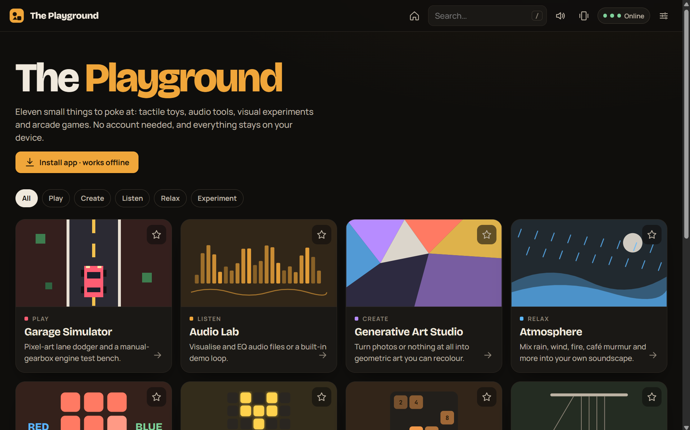

# The Playground

Eleven browser experiences in one static web app: tactile toys, audio tools, visual experiments and arcade games. There's no build step, backend or account, and every sound and image is generated in code.



| Experience | What it is |
|---|---|
| Garage Simulator | 7 fictional cars, each with its own synthesised engine (3-cyl kei, 4-cyl hatch, turbo rally, flat-6, V8, V12, diesel). **Arcade Drive**: lane dodger with RPM/speed gauges driven by an automatic gearbox. **Engine Lab**: manual gearbox with clutch, stalls, redline, sound test |
| Audio Lab | Demo loop, local file, **shared browser tab** (EQ applies), **device/system audio** (visualise; desktop Chrome/Edge) or microphone → EQ → 6 visualiser modes |
| Generative Art Studio | Voronoi, mosaic, low-poly, grid, radial and shape generators; photo → geometric art; recolour regions, undo/redo, PNG export |
| Atmosphere | 9 procedurally synthesised ambience layers, presets, saved mixes, sleep timer |
| Color Clash | Match / odd-one-out / name-vs-colour / survival, 30/60/90 s |
| Lights Out | 3×3 to 6×6, always solvable, hint, undo, relaxed or move-limit |
| Number Merge | 2048-style: Classic 4×4, Relaxed 5×5, 2-minute Score Attack |
| Newton's Playground | Cradle, pendulum wave, double pendulum, bouncing balls, springs, gravity wells, dominoes, free build |
| Kinetic Sand | Cellular sand: pour, scoop, push, rake, walls, stones, glitter |
| Fidget Lab | 3 spinners, clicker, toggles, faders, detent dial, pop sheet, rolling beads, ratchet |
| Liquid Playground | Particle liquid (water, ink, oil, honey, acid) with floating, sinking, absorbing and dissolving objects |

## Run locally

ES modules need a web server (not `file://`):

```sh
python -m http.server 8000
# open http://localhost:8000/
```

## Deploy to GitHub Pages

1. Push this folder to a repository (files at the repo root).
2. Repository → **Settings → Pages** → Source: *Deploy from a branch* → branch `main`, folder `/ (root)`.
3. Open `https://<user>.github.io/<repo>/`.

Every path is relative and routing is hash-based (`#/garage`), so it works from any subpath and a page refresh never 404s. `.nojekyll` stops Jekyll from processing the files.

## Tests

```sh
node --test
```

The tests cover the Lights Out solvability, Number Merge merge rules and game-over detection, the drivetrain (start, pull away, clutch-required shifts, stalling), Voronoi/Delaunay geometry, and the liquid solver's stability (no escapes or NaNs, and oil settles above water).

## Structure

```
index.html, css/app.css         shell + design tokens
js/app.js                       router, home, settings, experience shell
js/registry.js                  the 11 experiences: metadata, card art, help text
js/core/                        storage (versioned localStorage), audio (one AudioContext + per-module buses), haptics, ui (knob, modal, toast, canvas sizing)
js/exp/<id>.js                  one module per experience: mount(el, api) → { reset, destroy }
js/exp/garage-engine.js, liquid-sim.js   pure simulation logic (tested)
sw.js, manifest.webmanifest     offline app shell / install
```

## Honest limitations

- **Haptics** use `navigator.vibrate`, which most desktop browsers and iOS Safari don't support. It's feature-detected and never required.
- **Device audio**: a shared browser tab (e.g. Spotify Web Player) is muted locally and replayed through the EQ, so EQ really works there. Whole-system audio (Spotify desktop app) can be captured on Windows/ChromeOS Chrome/Edge for visualisation, but no website can change another app's output. macOS (tab only), Firefox, Safari and phones can't share system audio, so use Microphone instead.
- **Install**: the home page shows an *Install app* button where the browser supports it (Chrome, Edge, Android). On iPhone/iPad use Safari → Share → Add to Home Screen.
- **Offline:** after the first visit the app shell is cached (network-first, cache fallback). Google Fonts are cached once they've loaded; until then the app falls back to system fonts.
- **Photos** are processed locally on a `<canvas>` and downscaled to 1000 px. Nothing is uploaded.
- **Physics, liquid and drivetrain** are playful approximations, not measurement or training tools.
- All data (settings, scores, presets, palettes, mixes) lives in this browser's `localStorage`. Use Settings → Export data or Reset all data to manage it.
